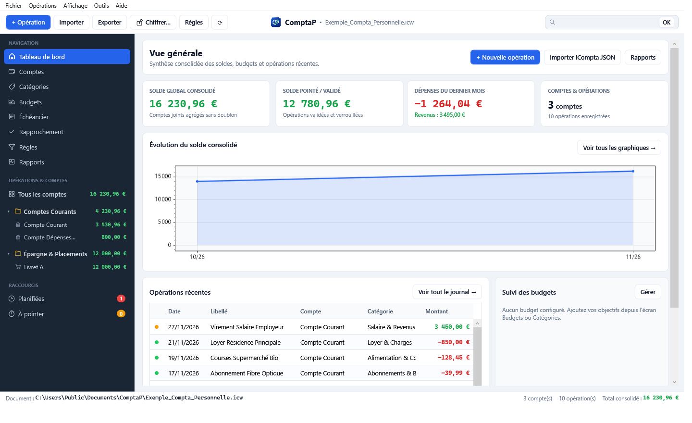
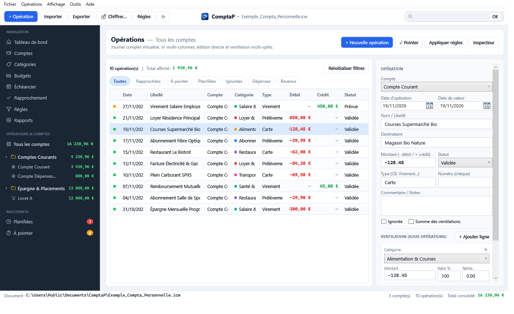
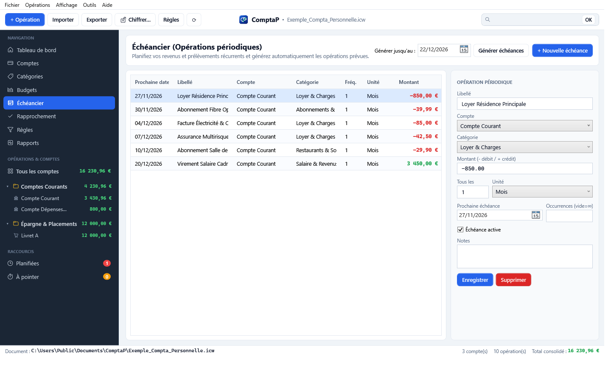

# 💎 ComptaP — Centre de Téléchargement Officiel (Windows 11)

  

Bienvenue sur le dépôt de distribution public officiel de **ComptaP** pour **Windows 11 (x64)**.

  
  
  
  
  

---

### 📦 Télécharger la dernière version (`v1.0.0`)

👉 **[Télécharger ComptaP v1.0.0 (Dernière version)](https://github.com/SharkLog76/comptap-releases/releases/latest)**

- **Windows 11 — `ComptaP-Setup-1.0.0.exe`** *(Recommandé)* :
  - Assistant d'installation complet en français.
  - Raccourcis Menu Démarrer et Bureau avec logo officiel ComptaP.
  - Association automatique des documents `.icw` et menu contextuel pour les fichiers Mac `.cdb`.
  - Désinstallation propre et automatisée via les paramètres Windows.
- **Windows 11 — `ComptaP-win-Portable.zip`** :
  - Archive portable autonome prête à l'emploi.
  - Décompressez et lancez directement `ComptaP.exe` sans droits administrateur ni modification du registre.

---

### 🌟 Aperçu de l'Application (Données Spécimens)

| Synthèse Générale & Soldes Consolidés | Journal des Opérations & Inspecteur Multi-Splits |
| :---: | :---: |
|  |  |

 

| Échéancier des Opérations Périodiques |
| :---: |
|  |

---

### ⚡ Points Forts de ComptaP

- **Exécutable natif Windows 11 ultra-performant** : Développé en C# .NET 10 et WPF avec moteur SQLite embarqué local. Zéro Docker, zéro serveur web, zéro latence même au-delà de 20 000 opérations.
- **Compatibilité native iCompta macOS (`.cdb`)** : Ouvrez directement vos fichiers de comptabilité Mac historiques sans conversion ni export intermédiaire.
- **Format de travail `.icw` haute performance** : Format document moderne, léger et optimisé pour Windows 11.
- **Haute sécurité & Chiffrement fort AES-256** : Verrouillez vos documents avec un mot de passe fort et dérivation de clé PBKDF2 (100 000 itérations).
- **Sauvegarde miroir automatique `.bak`** : Copie préventive créée avant chaque enregistrement avec restauration instantanée en un clic.
- **Réouverture automatique** : L'application réouvre immédiatement votre dernier document de travail au démarrage.
- **Échéancier & Opérations planifiées** : Planifiez vos échéances récurrentes avec montants et catégories ventilées, visualisez les flux anticipés dans le journal (`Status: Prévue`).
- **Comptes consolidés & Arborescence** : Gestion complète des comptes joints, livrets, cartes à débit différé et dossiers personnalisés.
- **Budgets, Rapprochement & Règles** : Pilotage budgétaire mensuel, pointage de relevé bancaire et moteur de règles d'automatisation.

---

### ⌨️ Raccourcis Clavier Essentiels

| Raccourci | Action |
| :--- | :--- |
| `Ctrl + N` | Nouvelle opération |
| `Ctrl + O` | Ouvrir un document (`.icw`, `.cdb`) |
| `Ctrl + S` | Enregistrer le document |
| `Ctrl + E` | Exporter les données |
| `Ctrl + I` | Gestionnaire d'import / export |
| `F5` | Actualiser le journal et les soldes |

---

### ℹ️ Informations Légales & Propriété
Ce produit est sous licence propriétaire fermée (*Closed Source*). Tous droits réservés &copy; 2026 ComptaP.
Aucun code source n'est distribué sur ce dépôt.